<div align="center">

# 🎵 Workshop 2 · Reliable Batch Data Pipeline
### Spotify × Grammy Awards

**ETL (G01)** · Data Engineering and Artificial Intelligence · Universidad Autónoma de Occidente

</div>

A batch pipeline, orchestrated by Apache Airflow 3.1.8, that extracts Spotify data from a CSV and Grammy data from PostgreSQL, validates both with Great Expectations, transforms and integrates them, validates the result again and loads a star schema in PostgreSQL. Every claim below links to evidence in [`docs/evidence/`](docs/evidence/).

> [!NOTE]
> **Status.** Workshop Sec. 6.1–6.11 and Sec. 7 are implemented and were executed in Docker: successful run, three controlled failures, safe rerun and a transient-failure retry. The KPI queries run on the DW. **The Power BI dashboard is still pending (Sec. 8).**

---

<a id="s1"></a>

## 🎯 1. Problem and analytical objective

Relate Grammy recognition to Spotify popularity, genre and sound. Neither source can answer this alone, and they share no identifier, so the pipeline has to integrate them by name. The match rate is therefore treated as a quality metric, not a footnote.

**Scope.** In scope: artist-level and track-level integration, two validation gates, a star schema, KPIs from the DW. Out of scope: causal claims, nominees who did not win (the source holds winners only), live Spotify API enrichment.

---

<a id="s2"></a>

## 📋 2. Analytical requirements

| ID | Question (decision supported) | Required data (← source) | KPIs | Level of detail |
|---|---|---|---|---|
| **AR-01** | Do Grammy-winning artists have higher Spotify popularity than artists without a win? (Is a Grammy a useful curation signal?) | `artists`, `track_id`, `popularity`, `track_genre` ← Spotify CSV · `artist`, `year` ← Grammy DB | **KPI-01** average popularity, winners vs non-winners, and the gap · **KPI-02** share of high-popularity tracks (≥ 70) with a Grammy-winning artist | one row per (track, artist) with the artist's win count; sliceable by genre |
| **AR-02** | Which Spotify genres concentrate the most Grammy-winning artists and wins? (Which genres to prioritise in award-oriented playlists?) | `track_genre`, `artists` ← Spotify · `artist`, `year`, `category` ← Grammy | **KPI-03** Grammy wins per genre · **KPI-04** winning artists per genre and their share | one row per (genre, artist); sliceable by decade |
| **AR-03** | How do the audio features of Grammy-winning recordings differ from the catalogue, and how do they change by decade? | `track_name`, `album_name`, audio features ← Spotify · `nominee`, `artist`, `year` ← Grammy | **KPI-05** audio profile of matched winners by decade vs catalogue · **KPI-06** integration match rate | one row per matched (award, track) pair |

**Why both sources:** Spotify has popularity, genres and audio features but no award signal; Grammy has awards, years and categories but no popularity, Spotify genre or audio features.

**Known limits.** (1) Every Grammy row has `winner = True`, so the comparison group is "Spotify artists with no win in the data". (2) Popularity is a snapshot at collection time, so results describe association, not cause. (3) Spotify has no release date, so time comes from the Grammy `year`.

**Traceability IDs** used across code, tests and evidence: `AR` requirement · `KPI` · `P-S/P-G/P-X` profiling evidence · `RISK` quality risk · `DQ` quality rule · `GX` expectation · `TR` transformation rule · `DW-F/D/B` fact, dimension, bridge.

---

<a id="s3"></a>

## 🗂️ 3. Data sources

| Source | Provided as | Pipeline extracts from | Size |
|---|---|---|---|
| Spotify | `data/raw/spotify_dataset.csv` | the CSV file | 114,000 × 21 |
| Grammy Awards | `data/raw/the_grammy_awards.csv` | PostgreSQL table `grammy_source.grammy_awards` | 4,810 × 10 (+ `grammy_row_id`) |

**Source preparation (Sec. 6.2).** `src/prepare_source.py` (job `prepare-source`) loads the Grammy CSV **as delivered** into `grammy_awards` ([`sql/source_setup.sql`](sql/source_setup.sql)) in one transaction (drop + create + `COPY`) and reconciles CSV vs table on 15 checks: rows, year range, distinct categories, winners and empty values per column. All match: [`source_prep_reconciliation.json`](docs/evidence/source_prep_reconciliation.json). This is not the ETL Load. It only creates the operational source. The same job creates the empty `music_dw` database if it is missing.

| Decision | Reason |
|---|---|
| No trimming, casing or imputation | The raw gate must see the real source quality |
| Empty CSV field → `NULL` | How a relational source represents "no value"; the reconciliation counts both |
| Surrogate `grammy_row_id` (row position) as PK | No natural key: `(year, category, nominee, artist)` contains NULLs |
| Originals kept with [`data/raw_checksums.sha256`](data/raw_checksums.sha256) | Proves the inputs were not changed |

Proof that the pipeline reads Grammy from the database and not from the CSV: the `extract_grammys` log line `rows=4810 (db count=4810) from grammy_source.grammy_awards` ([log](docs/evidence/airflow/logs/testA_success__extract_grammys__attempt1.log)).

---

<a id="s4"></a>

## 🏗️ 4. Pipeline architecture

<div align="center">
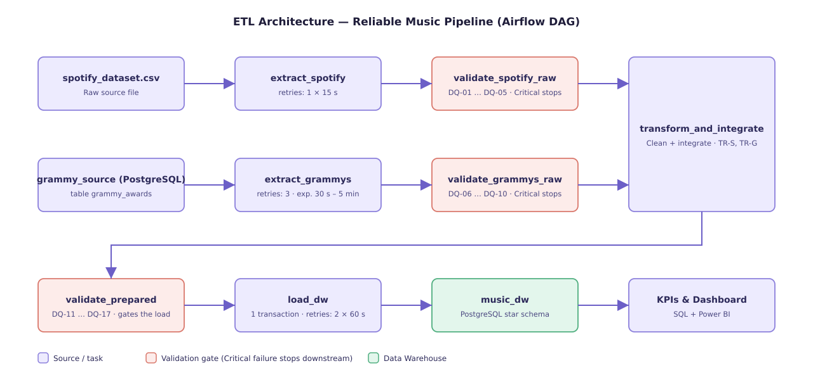
</div>

The pipeline is a **batch ETL** (transform before load) orchestrated by a single Airflow DAG, [`dags/reliable_music_pipeline.py`](dags/reliable_music_pipeline.py), written with the TaskFlow API (`from airflow.sdk import dag, task`). The two sources are extracted and validated **independently and in parallel**, converge in one transformation step, pass a second validation gate, and only then are loaded into the star schema. The logic of each task lives in `src/` (`extract.py`, `validation.py`, `transform.py`, `load.py`); the DAG only describes the workflow.

| # | Task | What it does | Failure policy |
|---|---|---|---|
| 1 | `extract_spotify` | Reads the Spotify CSV and stages it with a checksum | Retries: 1 × 15 s |
| 2 | `extract_grammys` | Reads Grammy data from the PostgreSQL source table, **not** from the CSV | Retries: 3, exponential 30 s to 5 min |
| 3 | `validate_spotify_raw` | Raw gate, rules DQ-01 to DQ-05 | No retry; Critical failure stops downstream |
| 4 | `validate_grammys_raw` | Raw gate, rules DQ-06 to DQ-10 | No retry; Critical failure stops downstream |
| 5 | `transform_and_integrate` | Cleans, standardizes and integrates both sources (TR-S01 to TR-S08, TR-G01 to TR-G06, integration contract). Starts only when **both** raw gates pass | No retry |
| 6 | `validate_prepared` | Prepared gate, rules DQ-11 to DQ-17 | No retry; Critical failure blocks the load |
| 7 | `load_dw` | Writes the star schema in one transaction with an advisory lock and reconciles row counts | Retries: 2 × 60 s |

**How to read it**

- **Validation gates.** Each gate runs Great Expectations Checkpoints and applies the severity policy: Critical stops the pipeline, Warning is recorded and the run continues, Informational is only recorded. When a gate fails, every downstream task ends as `upstream_failed`.
- **Selective retries.** Only tasks that touch a file or a database can fail for transient reasons (the two extractions and the load, which is a single transaction and therefore safe to repeat). Every data-quality or contract error raises `AirflowFailException`, which Airflow never retries.
- **Light task interfaces.** Tasks exchange compact metadata (paths, row counts, SHA-256, batch id, gate summary), never data frames, and each task re-verifies the checksum of the files it reads.
- **Source preparation is not the ETL load.** `src/prepare_source.py` copies the Grammy CSV into PostgreSQL once, before the DAG runs, so the pipeline has a relational source to extract from.

---

<a id="s5"></a>

## 🔍 5. Data profiling findings and quality risks

Notebook: [`notebooks/data_profiling.ipynb`](notebooks/data_profiling.ipynb) (read-only, reproducible). Every table and figure is in [`docs/evidence/profiling/`](docs/evidence/profiling/) under its evidence ID; the full register is [`RISKS_register.csv`](docs/evidence/profiling/RISKS_register.csv).

| Risk | Dataset / attribute | Evidence | Risk to the requirement | Dimension | AR |
|---|---|---|---|---|---|
| RISK-01 | Grammy `winner` | `True` in 4,810/4,810 (P-G-07) | No winner-vs-nominee analysis possible | Validity | all |
| RISK-02 | Grammy `artist` | 38.25% missing; 100% of Song Of The Year (P-G-02, P-G-08, P-G-09) | Iconic categories drop out of every artist join | Completeness | all |
| RISK-03 | Grammy `nominee` | 6 missing (P-G-02) | Those rows cannot match a track | Completeness | AR-03 |
| RISK-04 | Spotify `track_id` | 24,259 repeated rows across genres; 450 exact duplicates; 720 ids with different popularity per genre (P-S-03) | Counting rows double-counts tracks | Uniqueness | all |
| RISK-05 | Spotify `artists` | 26.4% multi-artist (`;`); trailing spaces (P-S-04) | Collaborations invisible to the join | Consistency | AR-01, AR-02 |
| RISK-06 | Both: names | No shared key; exact 31.2% → normalized 33.1% → + split 38.6% of Grammy artists; 3-char false positives (P-X-01, P-X-04, P-X-08) | Misses and false matches | Consistency | all |
| RISK-07 | Both: coverage | Exploratory track/album match: 444 of 4,810 rows (9.2%) (P-X-03) | KPIs describe the matched subset only | Representativeness | all |
| RISK-08 | Spotify `tempo`, `duration_ms`, `loudness` | 157 tempo = 0; 1 duration = 0; 90 loudness > 0 dB (P-S-06) | Placeholder zeros distort averages | Validity | AR-03 |
| RISK-09 | Spotify `popularity` | 14.1% rows = 0 (P-S-06, figure) | Real zero vs no data indistinguishable | Accuracy | AR-01 |
| RISK-10 | Spotify row 65900 | no artist, track or album (P-S-02) | Unattributable fact row | Completeness | all |
| RISK-11 | Grammy `category` | 638 labels, case-only variants (P-G-04) | One category split in two | Consistency | AR-03 |
| RISK-12 | Grammy `year`, `published_at` | `published_at` = web publication (4 values); Spotify has no date (P-G-06) | Wrong event date | Validity / timeliness | AR-02, AR-03 |
| RISK-13 | Grammy `(Various Artists)` | 66 rows (P-G-05) | Placeholder counted as an artist | Validity | AR-01, AR-02 |
| RISK-14 | Grammy `nominee` | song, album or person. A track-name match gives up to 9 Spotify versions (P-X-05); an album-name match gives every track of the album (up to 110) | One-to-many fan-out | Consistency | AR-03 |

The 9.2% in RISK-07 is the crude exploratory match of the notebook. The final integration contract (Sec. 8) reaches 544 of 4,257 matchable rows (**12.8%**).

---

<a id="s6"></a>

## 📏 6. Quality rules

**17 rules**: 13 Critical, 3 Warning, 1 Informational. Each one protects a requirement and comes from profiling evidence, a source contract or a post-transformation invariant. The registry is `RULES` in [`src/validation.py`](src/validation.py): the suites, the GX project and the Expectation → Rule map are all generated from it. Constraints the database already enforces (PK, FK, `UNIQUE`, `CHECK`) are not repeated as rules.

| Rule ID | Dataset / Layer | Attribute(s) | Quality Dimension | Quality Rule | Metric / Threshold | Severity | Related Requirement | Justified by |
|---|---|---|---|---|---|---|---|---|
| DQ-01 | Raw · Spotify | all required columns; row count | Validity (structure) / completeness (volume) | The 21 required columns exist and the extract is neither empty nor truncated. | missing columns = 0; 50,000 <= rows <= 500,000 | Critical | AR-01, AR-02, AR-03 | contract, P-S-01 |
| DQ-02 | Raw · Spotify | track_id | Validity / completeness (key) | track_id is present and is a 22-character base-62 Spotify id. | 100% non-null and 100% match ^[A-Za-z0-9]{22}$ | Critical | AR-01, AR-02, AR-03 | RISK-04 |
| DQ-03 | Raw · Spotify | popularity, danceability, energy, speechiness, acousticness, instrumentalness, liveness, valence, key, mode | Validity (domain) | popularity is in 0-100; bounded audio features are in [0, 1]; key is in 0-11; mode is in {0, 1}. | 100% within domain | Critical | AR-01, AR-03 | Spotify contract |
| DQ-04 | Raw · Spotify | artists, track_genre | Completeness | artists (the integration key with Grammy) and track_genre (the AR-02 axis) are present. | artists non-null >= 99%; track_genre 100% non-null | Critical | AR-01, AR-02, AR-03 | RISK-10 |
| DQ-05 | Raw · Spotify | tempo, loudness, duration_ms | Validity (placeholders / plausibility) | tempo is a real measurement (> 0, since 0 is Spotify's 'not detected'); loudness is within [-60, 0] dB; duration is within (0, 2 h]. | share plausible >= 99% for each column | Warning | AR-03 | RISK-08 |
| DQ-06 | Raw · Grammy | all required columns; row count | Validity (structure) / completeness (volume) | The 11 columns of the source table exist in the database extract and it is neither empty nor truncated. | missing columns = 0; 1,000 <= rows <= 20,000 | Critical | AR-01, AR-02, AR-03 | contract, P-G-01 |
| DQ-07 | Raw · Grammy | grammy_row_id | Uniqueness | grammy_row_id is the primary key: present and unique. | 100% non-null and unique | Critical | AR-02, AR-03 | source PK |
| DQ-08 | Raw · Grammy | year | Validity (domain) | year is an award-year label between the first ceremony (labelled 1958) and the current year. | 1958 <= year <= current year (2026 at design time), 100% | Critical | AR-02, AR-03 | RISK-12 |
| DQ-09 | Raw · Grammy | artist | Completeness | Enough award entries carry an artist to support artist-level integration. | non-null >= 50% (baseline 61.75%) | Warning | AR-01, AR-02, AR-03 | RISK-02 |
| DQ-10 | Raw · Grammy | winner | Consistency (scope monitoring) | The source keeps its documented scope: winners only. | winner = True for 100% of rows | Informational | AR-01, AR-02, AR-03 | RISK-01 |
| DQ-11 | Prepared | track_id, artist_norm, artist_position, is_primary_artist | Uniqueness / completeness (grain) | Exactly one row per (track, artist), with keys present and exactly one primary artist per track. | duplicate (track_id, artist_norm) = 0; keys 100% non-null; artist_position >= 1; is_primary_artist <=> position = 1 | Critical | AR-01, AR-02, AR-03 | grain of DW-F1 |
| DQ-12 | Prepared | popularity, danceability, energy, valence, tempo_bpm, duration_ms | Validity (domain, post-transformation) | After transformation: popularity in [0, 100]; danceability/energy/valence in [0, 1]; tempo_bpm > 0 and duration_ms > 0 when present (placeholder zeros are NULL). | 100% within domain (NULL allowed only for tempo_bpm and duration_ms) | Critical | AR-01, AR-03 | TR-S05 invariant |
| DQ-13 | Prepared | artist_norm, is_grammy_winner, grammy_win_count | Uniqueness / consistency (integration key) | One row per normalized artist; the Grammy placeholder never becomes an artist; the winner flag agrees with the win count. | artist_norm unique and not a placeholder (100%); is_grammy_winner <=> grammy_win_count >= 1 | Critical | AR-01, AR-02 | RISK-05, RISK-13 |
| DQ-14 | Prepared | grammy_row_id, year, category_key, win_count; row count | Completeness / uniqueness (reconciliation) | No Grammy award entry is lost or duplicated by the transformation, and the foreign keys of the fact are valid. | prepared rows == raw rows (runtime value); grammy_row_id unique; year in [1958, current year]; category_key not null; win_count = 1 | Critical | AR-02, AR-03 | grain of DW-F2 |
| DQ-15 | Prepared | spotify_winner, spotify_non_winner (helper flags) | Completeness (analytical readiness) | AR-01 has two non-trivial comparison groups: Spotify artists with and without Grammy wins. | winners in Spotify >= 30 AND non-winners in Spotify >= 30 | Critical | AR-01 | analytical readiness |
| DQ-16 | Prepared | is_track_matched among is_matchable | Consistency (integration integrity) | The track-level integration did not collapse: a minimum share of matchable Grammy rows matched a Spotify track. | matched / matchable >= 1% (observed 12.8%) | Critical | AR-03 | RISK-06, RISK-07 |
| DQ-17 | Prepared | matched_track_count | Consistency (cardinality) | Only a small share of award entries fan out to many Spotify tracks. A few long albums or box sets are expected; a widespread fan-out is not. | matched_track_count <= 15 for >= 99% of rows (baseline: 4 of 4,810 = 0.08%) | Warning | AR-03 | RISK-14 |

The table follows the columns of Workshop Sec. 6.5. It is the executable registry `RULES` rendered as text: the suites, the GX project and the Expectation → Rule map are generated from the same registry.

**Why these thresholds** (decided from the domain and the requirement, not from what the current batch passes):

- **DQ-01 / DQ-06:** the volume floor is about half of the observed volume for Spotify and about 20% for Grammy. It catches an empty or truncated extract without alarming on a smaller legitimate sample.
- **DQ-03 / DQ-08:** the domains come from Spotify's documentation and the Grammy history, so any value outside them is impossible, not noisy. Tolerance is zero.
- **DQ-04:** above 1% of rows without an artist, the integration is no longer representative. The observed share is 0.001%.
- **DQ-05:** a share p of zero tempos biases the mean by about p × mean, so 1% means about 1.2 BPM. The transformation nulls these values, which is why this rule is a Warning.
- **DQ-09:** below 50%, fewer than half of the entries could ever match. It is a Warning because KPI-06 already labels the coverage.
- **DQ-15:** 30 observations per group is the usual minimum for a stable comparison of two means.
- **DQ-16:** below 1% (about 40 rows) the key or the normalization is broken.
- **DQ-17:** an album title legitimately matches every track of the album (*The Complete Hank Williams* 110, *The Wall* 21, *Abbey Road* 18), so a per-row cap would warn on every healthy batch and the warning would stop meaning anything. The signal worth a Warning is a *widespread* fan-out (generic titles, an over-matching normalization). 1% of the 4,810 entries is 48 rows: 12 times the baseline of 4 rows and about 9% of the 544 matched entries. Rows above 15 stay in the bridge and are listed in the gate report (`partial_unexpected_list`).

**Severity policy.**

| Severity | Pipeline action |
|---|---|
| Critical | The gate task fails (`DataQualityError` → `AirflowFailException`, no retry) and downstream tasks end `upstream_failed` |
| Warning | The rule id is logged as `WARNING` and recorded in the JSON report; the run continues |
| Informational | Recorded for monitoring; never blocks |

---

<a id="s7"></a>

## ✅ 7. Great Expectations validation design

| Element | Implementation |
|---|---|
| Expectation | 58 expectations. Each carries `meta = {rule_id, gx_id, severity}`. Map: [`gx_expectation_map.csv`](docs/evidence/validation/gx_expectation_map.csv) |
| Expectation Suite | One per dataset: `spotify_raw`, `grammy_raw`, `prepared_artist`, `prepared_track_artist`, `prepared_grammy_award` (`gx/expectations/`) |
| Validation Definition | `<dataset>_validation` binds the dataset's `whole_dataframe` batch definition to its suite (`gx/validation_definitions/`) |
| Checkpoint / execution | `<dataset>_checkpoint`, one per dataset (`gx/checkpoints/`). There is one per dataset because `Checkpoint.run` feeds one DataFrame and the prepared gate validates three. Each Airflow gate runs the Checkpoints of its datasets |
| Policy | GX's overall `success` is all-or-nothing, so `evaluate_gate()` applies the severity table itself |
| Result | A per-rule JSON report is written **before** the policy is applied, so a blocked batch still leaves its evidence: `docs/evidence/validation/<gate>__<run_id>.json` (observed values, unexpected counts, sample of offending values) |

**Two details that look like inconsistencies but are by design.** (1) The committed `gx/` project holds **57** expectations and the map lists **58**: the 58th is the `DQ-14` row-count expectation (prepared rows = raw rows), which needs the raw row count and therefore exists only at run time. Its id (`GX-506`) is reserved so ids are identical in `gx/`, the map and the run reports. (2) The suite JSON files show GX's own `"severity": "critical"` on every expectation. The project's severity (Critical / Warning / Informational) is the one in each expectation's `meta.severity`, and it is what `evaluate_gate()` applies; GX's native field is left at its default and is not used for policy.

At run time each gate builds an **ephemeral** GX context from the registry, because the two raw gates run in parallel and must not write to the same files. `python -m src.validation export-docs` writes the same objects to `gx/` and regenerates the map.

---

<a id="s8"></a>

## 🔄 8. Transformation and integration

One phase. It starts only after **both** raw gates pass. No rule exists to make a validation pass; each one cites its own evidence. Logic: [`src/transform.py`](src/transform.py). Per-run reconciliation: [`reconciliation__testA_success.json`](docs/evidence/transformation/reconciliation__testA_success.json).

| ID | Rule (evidence) | Fields | Before → after | Exceptions | Impact |
|---|---|---|---|---|---|
| TR-S01 | Drop rows without artist (RISK-10) | row | 114,000 → 113,999 | counted; DQ-04 blocks above 1% | every join is by artist |
| TR-S02 | Remove exact duplicates of `(track_id, track_genre)` (RISK-04) | row | −450 | counted | no inflated counts |
| TR-S03 | One row per `track_id`; popularity = **mean** over genre listings (`max` would bias up) | all | 113,549 listings → 89,740 tracks | a column that varies within a track is reported | KPI-01/02 per track |
| TR-S04 | Trim text, `explicit` → bool, popularity 2 dp; missing name → `(unknown)`, never matched | names | — | 0 cases after TR-S01 | safe `dim_track` |
| TR-S05 | `tempo = 0`, `duration_ms = 0` → NULL (placeholders) (RISK-08) | `tempo_bpm`, `duration_ms` | 157 tempo zeros → NULL | NULL allowed by DQ-12 and schema | KPI-05 averages |
| TR-S06 | `popularity = 0` **kept** (RISK-09): changing it would invent data | — | 9,347 tracks | caveat on KPI-01 | — |
| TR-S07 | `is_high_popularity = popularity ≥ 70` | new | — | — | KPI-02 |
| TR-S08 | Split `artists` on `;` → one credit per artist, position, primary flag; drop `Various Artists` (RISK-05, RISK-13) | `artist_norm`, position | 89,740 tracks → 123,423 credits | a track left with no credit leaves the facts | collaborations join |
| TR-G01 | Trim/collapse text; empty → NULL | text | titles had double spaces | — | stable keys |
| TR-G02 | `category_key` = lower/trimmed label; name = most frequent spelling (RISK-11) | category | 638 → 629 keys | award without category member → contract error | AR-03 breakdown |
| TR-G03 | `ceremony_no`, `ceremony_title` from `title`; `published_at` never used as event date (RISK-12) | year attributes | — | two titles per year → contract error | `dim_year`, decade |
| TR-G04 | Best New Artist family: nominee **is** the artist (P-G-09) | `artist`, `artist_source` | 65 recovered | only if nominee present | AR-01/02 |
| TR-G05 | Performer in trailing parentheses of `workers` (`songwriters (Norah Jones)`); flagged and switchable (`ENABLE_WORKERS_RECOVERY`) | `artist`, `artist_source` | 1,333 recovered (1,289 after TR-G06) | no pattern → stays without artist | Song Of The Year can match |
| TR-G06 | `(Various Artists)` → NULL, applied after recovery (RISK-13) | `artist` | 111 rows | `artist_source = none` | no false match |

**Integration contract**

| Item | Decision and evidence |
|---|---|
| Key | `norm_key(name)`: accent-strip → casefold → drop bracketed text → punctuation to space → single spaces, applied identically to every name on both sides. Artist key `artist_norm`. Track level: `(artist_norm, norm_key(nominee))` vs `(artist_norm, norm_key(track_name \| album_name))` |
| Composite Grammy names | **exact** if the whole name is a Spotify artist (`Earth, Wind & Fire` stays intact); else **split** into parts of ≥ 4 normalized characters that exist in Spotify (3-char parts were the false positives of P-X-04); else **unmatched** and kept as a Grammy-only artist |
| Cardinality | many Grammy rows → one artist; award entry → tracks **one-to-many**, kept in the bridge `bridge_award_track` so a fan-out never multiplies wins. Verified by DQ-11, DQ-13, DQ-14 |
| Unmatched | measured, never dropped: 553 rows without artist, 1,821 unmatched, 1,902 exact, 534 split; 4,257 matchable → **544 matched (12.8%)**, 1,519 pairs (KPI-06) |
| Duplicates / ambiguity | a track matched by name and album is stored once as `track_name`; 263 entries match > 1 track; 4 exceed 15 (album-level matches, 0.08% of entries), inside the tolerance of **DQ-17** |
| Limitations | name equality, not identity (can miss or mismatch); only credited parts of a split composite are recorded; album matches weigh box sets more in per-pair averages |

**Reconciliation.** 114,000 raw − 1 − 450 = 113,549 listings → 89,740 tracks → 123,423 credits (29,767 artists). Grammy 4,810 raw = 4,810 prepared. Of the 544 matched entries, 401 have the artist in the source, 135 come from TR-G05 and 8 from TR-G04.

---

<a id="s9"></a>

## ⭐ 9. Dimensional model

Star constellation in PostgreSQL, [`sql/dw_schema.sql`](sql/dw_schema.sql). Two business processes with different grains share the conformed `dim_artist`.

<div align="center">
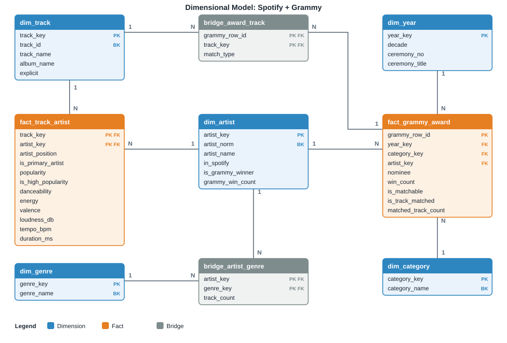
</div>

| ID | Table | Business process | Grain (one row = …) | Measures | Supports |
|---|---|---|---|---|---|
| DW-F1 | `fact_track_artist` | Spotify track credits: how a recording by an artist performs and sounds | one distinct Spotify track × one credited artist | `popularity` (non-additive), `is_high_popularity`, `danceability`, `energy`, `valence`, `loudness_db`, `tempo_bpm`, `duration_ms` | AR-01, AR-03 baseline |
| DW-F2 | `fact_grammy_award` | Grammy recognition: winning entries by year, category and artist | one Grammy award entry (`grammy_row_id`) | `win_count` (= 1), `is_matchable`, `is_track_matched`, `matched_track_count` | AR-02, AR-03, KPI-06 |
| DW-B1 | `bridge_artist_genre` | (resolves the many-to-many between artists and genres) | one (artist, genre) pair | `track_count` | AR-02 |
| DW-B2 | `bridge_award_track` | (resolves the one-to-many between an award entry and Spotify tracks) | one matched (award, track) pair | `match_type` | AR-03 |
| DW-D1…D5 | `dim_artist`, `dim_track`, `dim_genre`, `dim_category`, `dim_year` | (descriptive context of both processes; `dim_artist` is shared) | one member per business key | — | all |

**Keys.** Free-text dimensions use surrogate `IDENTITY` keys, each with a `UNIQUE` business key: `artist_norm`, `track_id`, `genre_name`, `category_norm`. `dim_year` uses the year itself as a smart key. `artist_key = 0` is the unknown member, so Grammy rows without an artist keep a valid FK and KPI-06 keeps its denominator. The PK of every fact is its grain, so a duplicate is physically impossible. `CHECK` constraints repeat the prepared invariants as a second line of defence. Wins per genre (KPI-03) are **not additive** across genres, because an artist counts in every genre they appear in.

| AR | Tables joined | How the question is answered |
|---|---|---|
| AR-01 | `fact_track_artist` JOIN `dim_artist` | Group by `is_grammy_winner` (and `in_spotify`) to compare popularity. For a genre slice, JOIN `bridge_artist_genre` and `dim_genre` |
| AR-02 | `bridge_artist_genre` JOIN `dim_genre` JOIN `dim_artist` | Count winning artists and wins per genre. For a decade slice, JOIN `fact_grammy_award` and `dim_year` |
| AR-03 | `fact_grammy_award` JOIN `bridge_award_track` JOIN `fact_track_artist` JOIN `dim_year` | Take the primary artist of each matched track and average its audio features by decade. The baseline comes from `fact_track_artist` alone |

---

<a id="s10"></a>

## 🌬️ 10. Airflow DAG design

`schedule=None`, `catchup=False`, `max_active_runs=1`, default `retries=0`, and a param `fault_injection` for Test B. The dependency rules are part of the code, not only of the drawing: `transform_and_integrate` takes the outputs of **both** raw gates as arguments, and `load_dw` takes the output of `validate_prepared`. With the default `all_success` trigger rule, a failed gate leaves every downstream task `upstream_failed`.

**Implemented DAG (Airflow Graph view, run `testA_success`).**

<div align="center">
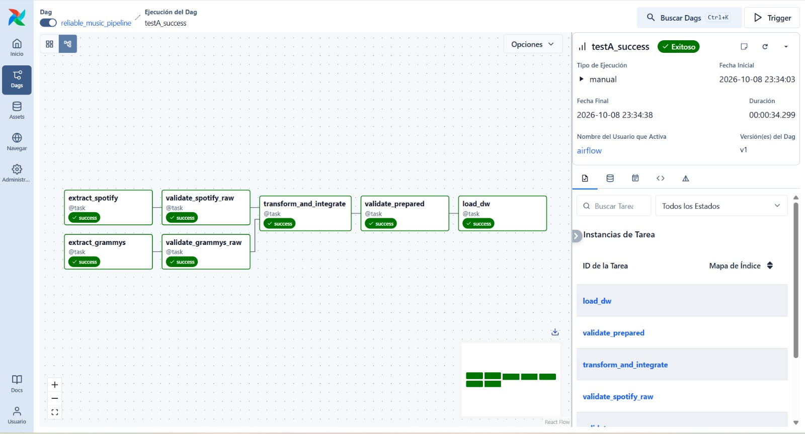
</div>

*Claim:* the DAG that Airflow executes has the architecture of Sec. 4. *Reading:* the two source branches (`extract_* → validate_*_raw`) are independent and both feed `transform_and_integrate`, so it cannot start until both raw gates succeed. `validate_prepared` is its only successor and `load_dw` has a single upstream, `validate_prepared`. In this run all seven tasks are `success`.

**Logging.** Each task logs the batch id (the sanitized `run_id`), the material row counts, the gate outcome (`PASSED: 5/5`, `WARNING rule DQ-05`, `FAILED on critical rule(s) ['DQ-08']` with the path of the evidence), the reconciliation and the load summary. Staged files and their `*.meta.json` stay in `data/staging/<batch_id>/` so a batch can be investigated.

**Observability (Sec. 6.11): six questions, six pieces of evidence.**

| Question | Evidence | Where |
|---|---|---|
| What ran? | DAG run id and task ids; the batch id (sanitized `run_id`) is in every log line | [`dag_runs.txt`](docs/evidence/airflow/dag_runs.txt), Airflow Grid view |
| When? | `run_after` and per-task start / end timestamps (manual runs in Airflow 3 have no logical date) | [`dag_runs.txt`](docs/evidence/airflow/dag_runs.txt), [`task_states.txt`](docs/evidence/airflow/task_states.txt) |
| Did it succeed? | DAG and task states, plus completion evidence: row counts, gate summary, load summary | [`task_states.txt`](docs/evidence/airflow/task_states.txt), [`load__testA_success.json`](docs/evidence/load/load__testA_success.json) |
| Where did it fail? | The failed task and the `upstream_failed` downstream tasks | [grid `testB_grammy_DQ-08`](docs/evidence/airflow/grid__testB_grammy_DQ-08.png), [`task_states.txt`](docs/evidence/airflow/task_states.txt) |
| Why? | Log line with the rule id and the path of the GX report; the report lists the observed values | [failed log](docs/evidence/airflow/logs/testB_grammy_DQ-08__validate_grammys_raw__attempt1.log), [`raw_grammy__testB_grammy_DQ-08.json`](docs/evidence/validation/raw_grammy__testB_grammy_DQ-08.json) |
| What happened next? | Retry (attempt 2 succeeds), stop (`upstream_failed`), or warning continuation, according to Sec. 11 | [attempt 1](docs/evidence/airflow/logs/retry_transient_db_outage__extract_grammys__attempt1.log) and [2](docs/evidence/airflow/logs/retry_transient_db_outage__extract_grammys__attempt2.log), [`prepared__testA_success.json`](docs/evidence/validation/prepared__testA_success.json) |

**Load strategy (Sec. 6.10)** in [`src/load.py`](src/load.py). Everything runs in **one transaction**:

1. `pg_advisory_xact_lock`, so two loads never interleave.
2. Apply the idempotent schema.
3. `COPY` the prepared files into temporary tables.
4. **Dimensions:** controlled upsert by business key. Only changed rows are updated and new members are inserted, so existing surrogate keys never change.
5. **Facts and bridges:** replaced, with keys resolved through the business keys.
6. Delete members that are no longer in the batch.
7. **Reconcile** the DW row counts against the prepared counts before `COMMIT`.
8. Write one audit row to `etl_load_audit`.

Any error rolls back everything, so the DW never holds half a batch.

---

<a id="s11"></a>

## 🛡️ 11. Failure and retry policy

| Condition | Type | Pipeline response | Retry | Justification |
|---|---|---|---|---|
| Grammy DB unreachable | Transient | `extract_grammys` retries | 3 × 30 s exponential (max 5 min) | Network dependency. 30/60/120 s covers a container restart without hiding a real outage |
| Spotify file momentarily unavailable | Transient | `extract_spotify` retries | 1 × 15 s | A local file has few transient causes |
| DW unreachable during load | Transient | `load_dw` retries | 2 × 60 s | The load is one transaction, so a retry starts from the last committed state and cannot duplicate |
| Missing file/table/column, empty source, checksum mismatch, batch mismatch | Deterministic contract | `AirflowFailException`, immediate | No | Repeating reproduces the same error |
| Critical rule fails (raw or prepared) | Data quality | Gate fails; downstream `upstream_failed` | No | Same data → same result |
| Load reconciliation mismatch | Deterministic | Rollback + `AirflowFailException` | No | Indicates a code or contract bug |
| Warning / Informational | — | Logged and recorded; continue | n/a | Needs visibility, not a stop |
| `transform_and_integrate`, `validate_*` | Deterministic | Fail with cause | No (`retries=0`) | Pure computation over staged files |

**Selective-retry evidence.** In run `retry_transient_db_outage` the data database was stopped before extraction. Attempt 1 of `extract_grammys` failed with `OperationalError` ([log](docs/evidence/airflow/logs/retry_transient_db_outage__extract_grammys__attempt1.log)), the database came back, attempt 2 extracted 4,810 rows ([log](docs/evidence/airflow/logs/retry_transient_db_outage__extract_grammys__attempt2.log)), and the run ended `success` ([grid](docs/evidence/airflow/grid__retry_transient_db_outage.png)). The deterministic tasks in the same run never retried.

---

<a id="s12"></a>

## 🟢 12. Test A: successful run

Run `testA_success` (`fault_injection = none`): all 7 tasks `success` ([grid](docs/evidence/airflow/grid__testA_success.png), [states](docs/evidence/airflow/task_states.txt)).

<div align="center">
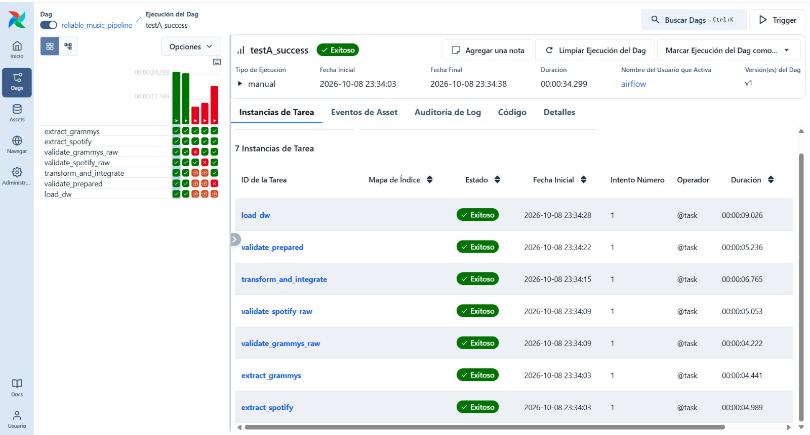
</div>

*Claim:* a clean batch crosses both raw gates, the transformation, the prepared gate and the load. *Reading:* the run `testA_success` ends `success` in 34.3 s. Both extractions start in the same second (23:34:03), which shows the two branches run in parallel; the raw gates follow at 23:34:09, `transform_and_integrate` at 23:34:15 (6.8 s), `validate_prepared` at 23:34:22 and `load_dw` at 23:34:28 (9.0 s). Every task shows attempt 1: nothing was retried.

| Stage | Result | Evidence |
|---|---|---|
| Extract both sources | 114,000 Spotify rows from CSV; 4,810 Grammy rows from PostgreSQL (`db count=4810`) | [log](docs/evidence/airflow/logs/testA_success__extract_grammys__attempt1.log) |
| Raw gates | Spotify 5/5, Grammy 5/5 | [`raw_spotify__testA_success.json`](docs/evidence/validation/raw_spotify__testA_success.json), [`raw_grammy__testA_success.json`](docs/evidence/validation/raw_grammy__testA_success.json) |
| Transform and integrate | reconciliation of Sec. 8 | [`reconciliation__testA_success.json`](docs/evidence/transformation/reconciliation__testA_success.json) |
| Prepared gate | 7/7 rules ok with the current DQ-17 (≥ 99% of rows), no Critical, no Warning. *The attached task log was captured earlier with the first DQ-17 (cap of 15 per row), which gave 6/7 with Warning DQ-17 and the run continued under policy.* | [`prepared__testA_success.json`](docs/evidence/validation/prepared__testA_success.json), [log](docs/evidence/airflow/logs/testA_success__validate_prepared__attempt1.log) |
| Load | `dim_artist` 30,910 · `dim_track` 89,740 · `dim_genre` 114 · `dim_category` 629 · `dim_year` 62 · `fact_track_artist` 123,423 · `fact_grammy_award` 4,810 · `bridge_artist_genre` 44,364 · `bridge_award_track` 1,519; reconciled | [`load__testA_success.json`](docs/evidence/load/load__testA_success.json) |
| Analytics | KPI queries read the DW | [`kpi_results.txt`](docs/evidence/analytics/kpi_results.txt) |

---

<a id="s13"></a>

## 🛑 13. Test B: controlled Critical failure

`fault_injection` changes **one** value after a clean step, logs `CONTROLLED FAULT INJECTED` and records the fault in the batch metadata, so it cannot be mistaken for a real source problem.

| Run | Injected condition | Blocking rule | Task states | Evidence |
|---|---|---|---|---|
| `testB_grammy_DQ-08` | one Grammy `year = 1850` after extraction | **DQ-08** (GX-206: 1 unexpected value, `[1850]`) | `extract_grammys` OK → `validate_grammys_raw` FAILED → transform, prepared, load `upstream_failed`; Spotify branch OK | [grid](docs/evidence/airflow/grid__testB_grammy_DQ-08.png) · [failed log](docs/evidence/airflow/logs/testB_grammy_DQ-08__validate_grammys_raw__attempt1.log) · [GX result](docs/evidence/validation/raw_grammy__testB_grammy_DQ-08.json) |
| `testB_spotify_DQ-03` | one Spotify `popularity = 150` | **DQ-03** | `validate_spotify_raw` FAILED; Grammy branch OK; downstream `upstream_failed` | [grid](docs/evidence/airflow/grid__testB_spotify_DQ-03.png) · [failed log](docs/evidence/airflow/logs/testB_spotify_DQ-03__validate_spotify_raw__attempt1.log) · [GX result](docs/evidence/validation/raw_spotify__testB_spotify_DQ-03.json) |
| `testB_prepared_DQ-12` | one prepared `popularity = 150` after transformation | **DQ-12** | both raw gates and transform OK → `validate_prepared` FAILED → **`load_dw` `upstream_failed`** | [grid](docs/evidence/airflow/grid__testB_prepared_DQ-12.png) · [failed log](docs/evidence/airflow/logs/testB_prepared_DQ-12__validate_prepared__attempt1.log) · [GX result](docs/evidence/validation/prepared__testB_prepared_DQ-12.json) |

**Evidence in the Airflow UI.** For each run, the Grid shows where the failure stops the flow and the log of the failed task names the blocking rule.

*Grammy branch, rule DQ-08 (`testB_grammy_DQ-08`).*

<div align="center">
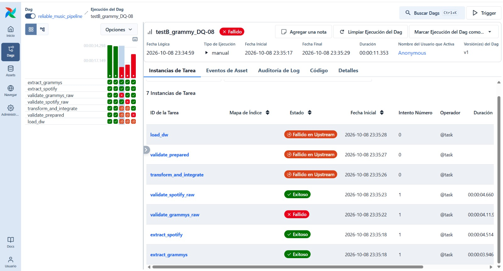
</div>

<div align="center">
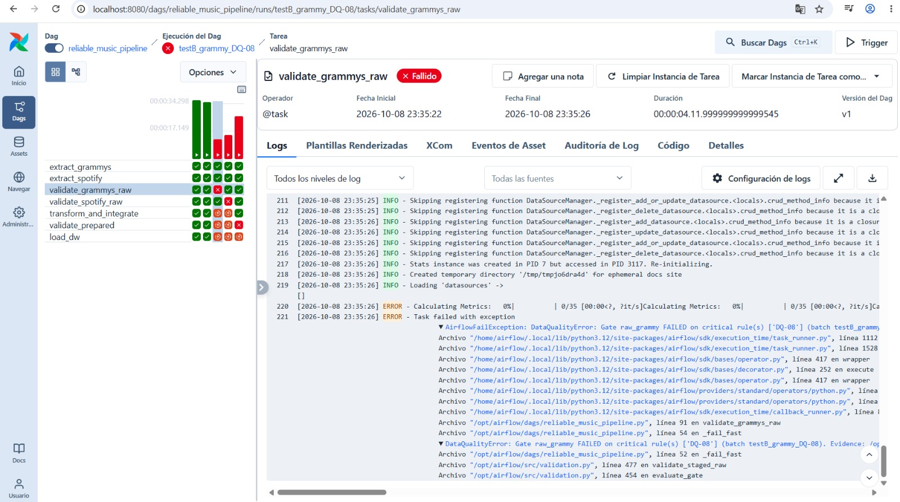
</div>

*Claim:* a Critical raw failure in the Grammy branch blocks everything downstream, and the cause is readable. *Reading:* both extractions and `validate_spotify_raw` are `success`; `validate_grammys_raw` is `failed` after one attempt (4.1 s); `transform_and_integrate`, `validate_prepared` and `load_dw` are `upstream_failed` with attempt 0, so they never started. The log ends in `AirflowFailException: DataQualityError: Gate raw_grammy FAILED on critical rule(s) ['DQ-08']` with the batch id and the path of the GX report. The injection itself is logged earlier, in [`extract_grammys`](docs/evidence/airflow/logs/testB_grammy_DQ-08__extract_grammys__attempt1.log) (`CONTROLLED FAULT INJECTED`).

*Spotify branch, rule DQ-03 (`testB_spotify_DQ-03`).*

<div align="center">
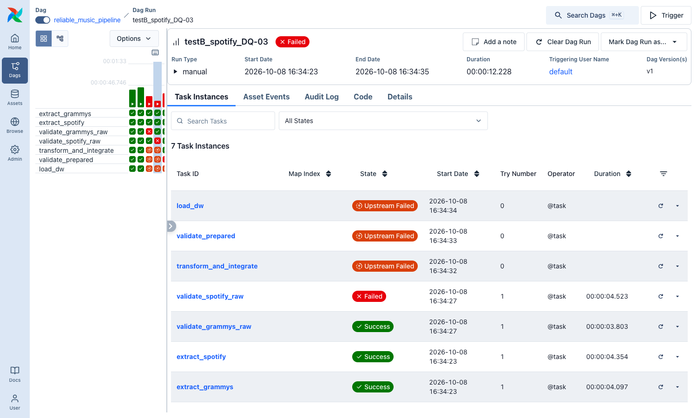
</div>

<div align="center">
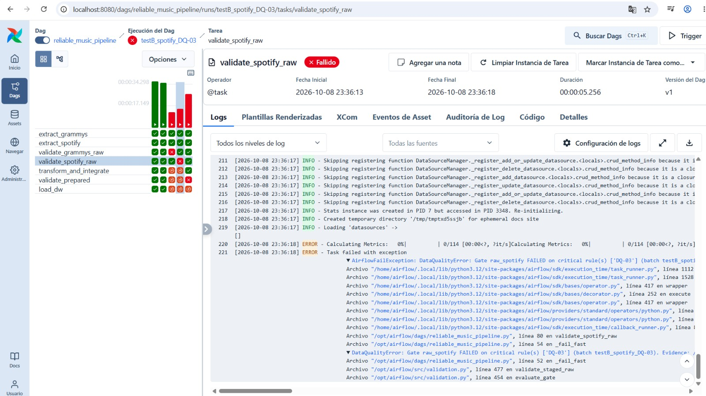
</div>

*Claim:* the branches fail independently. *Reading:* here the Grammy branch is complete (`extract_grammys` and `validate_grammys_raw` are `success`) while `validate_spotify_raw` is `failed` (5.3 s); the same three downstream tasks are `upstream_failed`. The log names `raw_spotify` and rule `DQ-03`.

*Prepared gate, rule DQ-12 (`testB_prepared_DQ-12`).*

<div align="center">
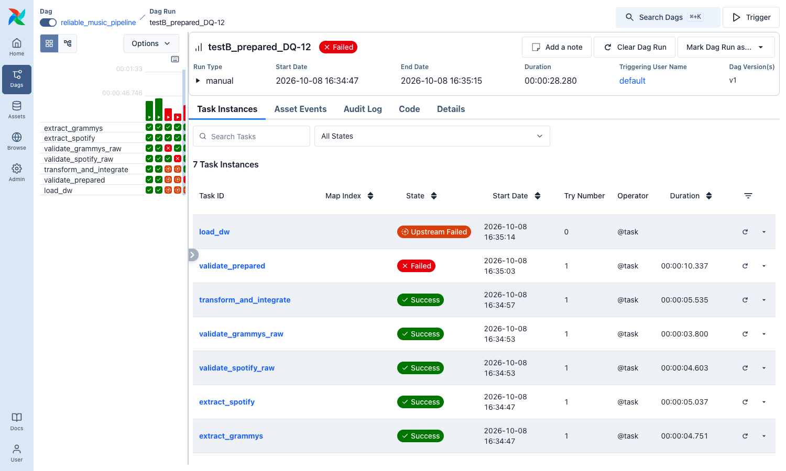
</div>

<div align="center">
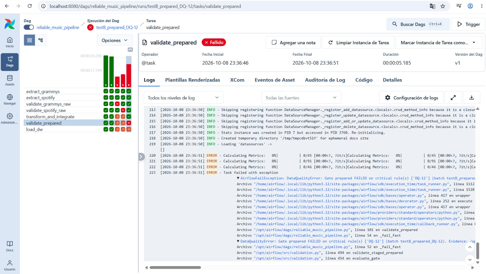
</div>

*Claim:* `load_dw` is gated by the Critical outcome of `validate_prepared`. *Reading:* both raw gates and `transform_and_integrate` are `success`, `validate_prepared` is `failed` (5.2 s) and `load_dw` is `upstream_failed` with attempt 0: nothing reached the Data Warehouse. The log names gate `prepared` and rule `DQ-12`.

**Explanation.** DQ-08 is Critical because a year outside 1958–current year has no `dim_year` member and would corrupt the decade axis of AR-02/AR-03. The gate wrote its report first and then raised `DataQualityError`, which became `AirflowFailException`: there was no retry, because the same data gives the same result. The failed log names the rule and the evidence file. Since `transform_and_integrate` needs both gate outputs, it never ran, so nothing was transformed or loaded and the DW kept the previous batch. The third case proves the second gate: a Critical prepared failure stops `load_dw`.

---

<a id="s14"></a>

## 🔁 14. Repeatability and safe rerun

**Strategy:** business-key enforcement for dimensions plus transactional replace of facts (Sec. 10). Run `testA_rerun_same_batch` loaded the same input again ([`load__testA_rerun_same_batch.json`](docs/evidence/load/load__testA_rerun_same_batch.json)):

| | Before rerun | After rerun |
|---|---|---|
| `fact_track_artist` / `fact_grammy_award` / `bridge_award_track` | 123,423 / 4,810 / 1,519 | 123,423 / 4,810 / 1,519 |
| `dim_artist` / `dim_track` | 30,910 / 89,740 | 30,910 / 89,740 |
| avg popularity · total wins · matched rows · winner artists | 33.4398 · 4,810 · 544 · 2,030 | 33.4398 · 4,810 · 544 · 2,030 |
| Dimension rows inserted / updated / deleted | — | 0 / 0 / 0 (surrogate keys unchanged) |

<div align="center">
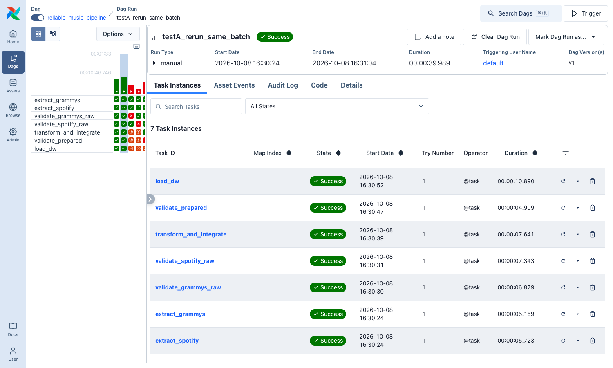
</div>

*Claim:* running the same input again completes normally and leaves the target unchanged. *Reading:* `testA_rerun_same_batch` ends `success` in 33.2 s with all seven tasks at attempt 1; the table above shows that row counts, measures and surrogate keys are identical to the first load.

`etl_load_audit` shows both loads with identical counts. **Partial or failed runs:** extract and transform write atomically (temp file + rename) keyed by batch id, so a rerun overwrites the same files. A failed or interrupted load rolls back completely. `tests/test_load.py::test_a_failed_load_rolls_back_and_leaves_the_previous_state` forces a reconciliation failure and checks that the previous state survives.

---

<a id="s15"></a>

## 🧾 15. Reliability evidence register

| ID | Run / task | Artifact | What it proves | Policy / rule |
|---|---|---|---|---|
| E-01 | `prepare-source` | [`source_prep_reconciliation.json`](docs/evidence/source_prep_reconciliation.json) | Grammy CSV = source table (15 checks) | Sec. 6.2 |
| E-02 | environment | [`airflow_version.txt`](docs/evidence/airflow/airflow_version.txt) | Airflow reports 3.1.8 | Sec. 6.2 |
| E-03 | profiling notebook | [`profiling/`](docs/evidence/profiling/) | 14 risks backed by tables and figures | RISK-01…14 |
| E-04 | GX design | [`gx_expectation_map.csv`](docs/evidence/validation/gx_expectation_map.csv) | 58 expectations → rule, suite, validation definition, checkpoint | Sec. 6.6 |
| E-05 | `testA_success` | grid, logs, `raw_*`, `prepared__`, `reconciliation__`, `load__` | Test A | DQ-01…17 |
| E-06 | `testB_grammy_DQ-08` | grid and log screenshots, failed log, GX JSON | raw Critical failure blocks downstream | DQ-08 |
| E-07 | `testB_spotify_DQ-03` | grid and log screenshots, failed log, GX JSON | same, other branch; branches independent | DQ-03 |
| E-08 | `testB_prepared_DQ-12` | grid and log screenshots, failed log, GX JSON | `load_dw` is gated by the prepared gate | DQ-12 |
| E-09 | `testA_rerun_same_batch` | [`load__testA_rerun_same_batch.json`](docs/evidence/load/load__testA_rerun_same_batch.json) | Rerun leaves counts, measures and keys unchanged | Sec. 7.3 |
| E-10 | `retry_transient_db_outage` | grid, attempt 1 and 2 logs | Retries apply to transient errors only | Sec. 6.11 |
| E-11 | all runs | [`dag_runs.txt`](docs/evidence/airflow/dag_runs.txt), [`task_states.txt`](docs/evidence/airflow/task_states.txt) | What ran, when, and with what state | Sec. 6.11 |
| E-12 | DW | [`kpi_results.txt`](docs/evidence/analytics/kpi_results.txt) | KPIs computed from the DW | Sec. 8.1 |
| E-13 | `pytest` | [`pytest_summary.txt`](docs/evidence/tests/pytest_summary.txt) | 67 passed: every rule fails when violated; extraction, transformation, prepared gate, load, rerun, rollback | all |
| E-14 | DW | [`kpi01b_expected_from_prepared_data.csv`](docs/evidence/analytics/kpi01b_expected_from_prepared_data.csv) | Sensitivity of KPI-01 to `popularity = 0`; expected output of `KPI-01b` | Sec. 8.1, RISK-09 |
| E-15 | `testA_success` | [`graph__dag_structure.png`](docs/evidence/airflow/graph__dag_structure.png) | The implemented DAG has two source branches, one convergence, the prepared gate and the load | Sec. 5, Sec. 6.11 |

---

<a id="s16"></a>

## 📊 16. Dashboard and analytical outputs

Every output below reads only `music_dw` (never a CSV). All queries are in [`sql/queries/kpi_queries.sql`](sql/queries/kpi_queries.sql); their results on the loaded DW are in [`kpi_results.txt`](docs/evidence/analytics/kpi_results.txt).

### 16.1 Requirement → DW element → KPI / visualization (Workshop Sec. 8.1)

6 KPIs and 3 analytical visualizations, plus one coverage indicator that travels with every visual.

| Analytical requirement | DW element / query | KPI / visualization |
|---|---|---|
| **AR-01** Do Grammy-winning artists have higher Spotify popularity? | `fact_track_artist` JOIN `dim_artist` · `KPI-01`, `KPI-01b`, `KPI-02` | **KPI-01** average popularity, winners vs non-winners, and the gap · **KPI-02** share of high-popularity tracks with a winning artist · **V-01** clustered columns: avg popularity per group, with and without `popularity = 0` (`KPI-01b`) |
| **AR-02** Which genres concentrate Grammy-winning artists and wins? | `bridge_artist_genre` JOIN `dim_genre` JOIN `dim_artist` · `KPI-03`, `KPI-04` | **KPI-03** wins per genre · **KPI-04** winning artists per genre and share · **V-02** horizontal bars, top 15 genres by wins, share of winning artists as a second measure (Top N filter in the BI tool); one query returns both measures: `V-02` in `kpi_queries.sql` |
| **AR-03** How do the audio features of Grammy-winning recordings differ from the catalogue, and by decade? | `bridge_award_track` → `fact_grammy_award` JOIN `dim_year` JOIN `fact_track_artist` · `KPI-05` | **KPI-05** audio profile of matched winners by decade vs catalogue · **V-03** lines by Grammy decade for energy, danceability and valence, with the catalogue average as a reference line |
| **AR-01…03** (coverage of every result) | `fact_grammy_award` · `KPI-06` | **KPI-06** integration match rate, shown as a card on every page of the dashboard |

**Dashboard design rules.** (1) Page title = the analytical question, not the table name. (2) KPI-06 is always visible, because every number describes the matched subset (12.8% of matchable entries). (3) V-01 must show both averages of `KPI-01b`; otherwise the chart hides the effect described below. (4) No decorative visuals: each one answers one requirement.

### 16.2 Results from the loaded DW

| AR | KPI | Result |
|---|---|---|
| AR-01 | KPI-01 | Winners 31.63 vs non-winners 33.61 (gap −1.98; 888 vs 28,879 artists). **No popularity advantage in the raw average** |
| AR-01 | KPI-02 | 1,033 of 3,121 high-popularity tracks (33.1%) have a Grammy-winning artist |
| AR-02 | KPI-03 / 04 | Most wins: soul 439, jazz 364, country 335. Most winning artists: soul 91 (28.8%), country 80, rock 80 |
| AR-03 | KPI-05 | Winners became louder and more energetic (1980s −12.4 dB / 0.48 → 2010s −7.5 dB / 0.59); catalogue −8.5 dB / 0.63 |
| AR-03 | KPI-06 | 544 / 4,257 matchable rows = 12.78% (11.31% of all rows) |

### 16.3 How to read KPI-01 (sensitivity to `popularity = 0`)

The negative gap is explained mostly by exact zeros, which RISK-09 flagged and TR-S06 deliberately kept as measured values: **25.7%** of the track credits of winning artists have `popularity = 0`, against **9.5%** for the rest. The data do not say why: splitting the winners by first Grammy year (before / from 1990) gives 29.7% vs 24.1% zeros, so the age of the catalogue alone does not explain it. Excluding the zeros reverses the sign:

| Group | Artists | Avg popularity (all) | Avg popularity (excl. 0) | Share of exact zeros |
|---|---|---|---|---|
| Grammy winner | 888 | 31.63 | **42.57** | 25.7% |
| No Grammy win | 28,879 | 33.61 | 37.12 | 9.5% |

Gap excluding zeros: **+5.45**. The first row of each pair reproduces `KPI-01` exactly (31.63 / 33.61 / 888 / 28,879), which is how the replication was validated. These figures were computed by replicating the `fact_track_artist` JOIN `dim_artist` grain from the prepared datasets ([`kpi01b_expected_from_prepared_data.csv`](docs/evidence/analytics/kpi01b_expected_from_prepared_data.csv)); **`KPI-01b` run on `music_dw` returns the same values** (second table of [`kpi_results.txt`](docs/evidence/analytics/kpi_results.txt)). The result stays an association: a zero may be a real zero or a missing measurement, and the data cannot tell which (README Sec. 19).

### 16.4 Dashboard connection and pages

Power BI Desktop → Get data → PostgreSQL, server `localhost:5433`, database `music_dw`, mode **Import**, credentials from `.env`. Each page loads its query from [`kpi_queries.sql`](sql/queries/kpi_queries.sql) through *Advanced options → SQL statement*, so the dashboard reads exactly the queries versioned here.

| Page (title = the question) | Query | Visual |
|---|---|---|
| AR-01 Do Grammy-winning artists have higher popularity? | `KPI-01b` (+ `KPI-01`, `KPI-02` as cards) | V-01 |
| AR-02 Which genres concentrate Grammy wins? | `V-02` (+ `KPI-03`, `KPI-04` as cards) | V-02 |
| AR-03 How do winning recordings sound by decade? | `KPI-05` (decade rows for the lines; the `catalogue` row as reference) | V-03 |
| Every page | `KPI-06` | match-rate card |

> [!WARNING]
> **Pending:** the Power BI dashboard (V-01…V-03 and the KPI-06 card) built from the pages above and connected to `localhost:5433/music_dw`.

---

<a id="s17"></a>

## 🧭 17. End-to-end traceability and evidence set

### 17.1 Traceability matrix (Workshop Sec. 8.2)

One row per **chain** that matters, not per requirement: each row follows one risk from the requirement it threatens to the KPI that would be wrong without the control. IDs are the ones used in the code, the tests and the evidence files (`RISK` → [`RISKS_register.csv`](docs/evidence/profiling/RISKS_register.csv), `DQ`/`GX` → [`gx_expectation_map.csv`](docs/evidence/validation/gx_expectation_map.csv), `TR` → Sec. 8, `KPI`/`V` → Sec. 16).

| # | Requirement | Required data | Quality risk | DQ rule | GX expectation | Transformation | DW element | KPI / visualization |
|---|---|---|---|---|---|---|---|---|
| 1 | AR-01 | Spotify `popularity` | RISK-09 (14.1% of rows are exactly 0); RISK-04 (720 ids with different popularity per genre) | DQ-03 (domain 0–100), DQ-12 (domain after transform) | GX-105; GX-408, GX-409 | TR-S03 (mean over genre listings), TR-S06 (zeros kept, not invented) | `fact_track_artist.popularity` | KPI-01, **KPI-01b**, KPI-02 · V-01 |
| 2 | AR-01, AR-02 | Spotify `artists` (several per row) | RISK-05 (26.4% of rows hold several artists), RISK-10 (1 row without artist) | DQ-04 (artists present), DQ-11 (one row per track × artist) | GX-115; GX-402, GX-405–407 | TR-S01, TR-S08 (split on `;`, position, primary flag) | `fact_track_artist` (grain), `dim_artist` | KPI-01, KPI-02 · V-01 |
| 3 | AR-01, AR-02, AR-03 | Spotify `artists` + Grammy `artist` (no shared id) | RISK-06 (names only), RISK-07 (33.1% of Grammy artists exist in Spotify), RISK-13 (`(Various Artists)` placeholder) | DQ-13 (one row per `artist_norm`, no placeholder), DQ-15 (both comparison groups ≥ 30), DQ-16 (match did not collapse) | GX-302–304; GX-308, GX-309; GX-507 | Integration contract (Sec. 8): `norm_key`, exact / split / unmatched; TR-G06 | `dim_artist` (`in_spotify`, `is_grammy_winner`, `grammy_win_count`) | KPI-01, KPI-04, **KPI-06** (card on every page) |
| 4 | AR-02 | Spotify `track_genre` | RISK-04 (24,259 rows repeat a track across genres; 450 exact duplicates) | DQ-02 (valid `track_id`), DQ-04 (genre never null) | GX-103, GX-104; GX-116 | TR-S02 (remove exact duplicates), `prepared_track_genre` | `bridge_artist_genre`, `dim_genre` | KPI-03, KPI-04 · V-02 |
| 5 | AR-02, AR-03 | Grammy `artist` | RISK-02 (38.25% missing; all *Song Of The Year* rows) | DQ-09 (≥ 50% present, Warning) | GX-207 | TR-G04 (Best New Artist: nominee is the artist), TR-G05 (performer in `workers`), flagged in `artist_source` | `fact_grammy_award.artist_key` (0 = unknown member), `dim_artist.grammy_win_count` | KPI-03, KPI-06 |
| 6 | AR-02, AR-03 | Grammy `year` | RISK-12 (`year` is an award label; `published_at` is a web date) | DQ-08 (1958 ≤ year ≤ current), DQ-14 (valid year, no row lost) | GX-205, GX-206; GX-503 | TR-G03 (+ decade derived in `prepared_year`; `published_at` never used) | `dim_year` (`decade`) | KPI-03 by decade, KPI-05 · V-03 |
| 7 | AR-03 | Spotify audio features, `tempo`, `duration_ms` | RISK-08 (157 `tempo = 0`, 1 `duration_ms = 0`, 90 `loudness > 0`) | DQ-05 (Warning, ≥ 99%), DQ-12 (zeros must be NULL after transform) | GX-117, GX-118, GX-119; GX-413, GX-414 | TR-S05 (placeholder zeros → NULL) | `fact_track_artist.tempo_bpm`, `.duration_ms` | KPI-05 · V-03 |
| 8 | AR-03 | Grammy `nominee` ↔ Spotify `track_name` / `album_name` | RISK-14 (nominee is a song, an album or a person), RISK-06 | DQ-16 (match rate ≥ 1%), DQ-17 (≤ 1% of entries above 15 tracks, Warning) | GX-507; GX-508 | Track-level match contract (Sec. 8): name match, then album match, stored once per pair | `bridge_award_track`, `fact_grammy_award.matched_track_count` | KPI-05, **KPI-06** · V-03 |
| 9 | AR-02, AR-03 | Grammy rows (4,810) | Silent row loss would inflate the match rate (RISK-02, RISK-11) | DQ-14 (prepared rows = raw rows, unique key) | GX-501, GX-502, GX-504, GX-505, GX-506 | TR-G01, TR-G02 (case variants collapse into one `category_key`); unmatched rows kept | `fact_grammy_award` (4,810), `dim_category` (629) | KPI-06 denominator |

**How to read a row** (row 3 as an example): AR-01 compares winners with non-winners, which needs both sources; they share no id (RISK-06), so DQ-13 and DQ-16 protect the integration key, TR-G06 and the integration contract build it, `dim_artist` stores the result, and KPI-01 / KPI-06 expose both the answer and its coverage.

**Coverage check.** Every one of the 17 rules appears in the matrix, except DQ-01, DQ-06, DQ-07 and DQ-10, which protect the structure of the extract (columns, volume, primary key, source scope) and therefore support all requirements equally rather than one chain.

### 17.2 Minimum evidence set (Workshop Sec. 8.3)

| Status | Required evidence | Where it is |
|---|---|---|
| **Done** | Analytical-requirement table and solution scope | Sec. 1 (scope), Sec. 2 (AR-01…03) |
| **Done** | Conceptual architecture and implemented DAG structure | Sec. 4, Sec. 10, [`dags/reliable_music_pipeline.py`](dags/reliable_music_pipeline.py), [grid](docs/evidence/airflow/grid__testA_success.png) |
| **Done** | Profiling notebook and evidence for both sources | [`notebooks/data_profiling.ipynb`](notebooks/data_profiling.ipynb), [`docs/evidence/profiling/`](docs/evidence/profiling/) (`P-S-*`, `P-G-*`, `P-X-*`), Sec. 5 |
| **Done** | Quality-risk analysis and quality-rule table | Sec. 5, Sec. 6, [`RISKS_register.csv`](docs/evidence/profiling/RISKS_register.csv) |
| **Done** | GX design and validation outputs for raw and prepared layers | Sec. 7, [`gx/`](gx/), [`gx_expectation_map.csv`](docs/evidence/validation/gx_expectation_map.csv), [`docs/evidence/validation/`](docs/evidence/validation/) (`raw_*`, `prepared__*`) |
| **Done** | Transformation and integration decision record | Sec. 8, [`reconciliation__testA_success.json`](docs/evidence/transformation/reconciliation__testA_success.json) |
| **Done** | Dimensional model and executable schema definition | Sec. 9, [`sql/dw_schema.sql`](sql/dw_schema.sql) |
| **Done** | Successful DAG Run evidence | Sec. 12, [grid](docs/evidence/airflow/grid__testA_success.png), [`task_states.txt`](docs/evidence/airflow/task_states.txt), [`load__testA_success.json`](docs/evidence/load/load__testA_success.json) |
| **Done** | Controlled failed DAG Run evidence, including failed task logs | Sec. 13, grids `testB_grammy_DQ-08`, `testB_spotify_DQ-03`, `testB_prepared_DQ-12` and their logs in [`docs/evidence/airflow/logs/`](docs/evidence/airflow/logs/) |
| **Done** | Selective-retry evidence or a justified explanation of tasks without retry | Sec. 11, E-10: [attempt 1](docs/evidence/airflow/logs/retry_transient_db_outage__extract_grammys__attempt1.log) and [attempt 2](docs/evidence/airflow/logs/retry_transient_db_outage__extract_grammys__attempt2.log) |
| **Done** | Safe-rerun evidence | Sec. 14, [`load__testA_rerun_same_batch.json`](docs/evidence/load/load__testA_rerun_same_batch.json), [grid](docs/evidence/airflow/grid__testA_rerun_same_batch.png) |
| **Pending** | Dashboard connection to the DW and requirement-to-KPI traceability | Traceability: Sec. 16.1 and Sec. 17.1 (done). **Power BI dashboard connected to `music_dw`: pending** |

The reliability evidence register of Sec. 15 lists the same artifacts by run (E-01…E-15).

---

<a id="s18"></a>

## ⚙️ 18. Setup and execution

**Prerequisites:** Docker Desktop (Compose v2) running and Python 3.10+. Commands are for Windows PowerShell; on Linux/macOS/Git Bash they are the same except where noted. Run everything from the repository root.

### 18.1 Local virtual environment (create once)

Airflow only runs inside Docker. The virtual environment is for the profiling notebook, the tests and `export-docs`; it does **not** install Airflow. It is also used here to generate the secrets.

```powershell
python -m venv .venv                       # Linux/macOS: python3 -m venv .venv
.\.venv\Scripts\Activate.ps1               # Linux/macOS/Git Bash: source .venv/bin/activate
#   If PowerShell blocks the script:
#   Set-ExecutionPolicy -Scope Process -ExecutionPolicy Bypass

python -m pip install --upgrade pip
pip install -r requirements.txt -r requirements-dev.txt -r requirements-notebook.txt
pip install cryptography                   # only to generate the Fernet key (step 18.2)
```

`.venv/` is git-ignored. Activate it again in every new terminal (`.\.venv\Scripts\Activate.ps1`); leave it with `deactivate`.

### 18.2 Configuration (.env)

```powershell
Copy-Item .env.example .env          # Linux/macOS: cp .env.example .env

# Generate each secret and paste it into .env replacing CHANGE_ME.
# Also set AIRFLOW_DB_PASSWORD and DATA_DB_PASSWORD (any strong password).
python -c "from cryptography.fernet import Fernet; print(Fernet.generate_key().decode())"   # AIRFLOW_FERNET_KEY
python -c "import secrets; print(secrets.token_urlsafe(48))"                                # AIRFLOW_JWT_SECRET
python -c "import secrets; print(secrets.token_urlsafe(48))"                                # AIRFLOW_API_SECRET_KEY
```

`.env` is git-ignored: never commit real credentials. Without a local Python, the same commands run in Docker: `docker run --rm apache/airflow:3.1.8 python -c "..."`.

### 18.3 Start the Docker stack (first time)

```powershell
# 1. Build the image (Airflow 3.1.8 + project dependencies)
docker compose build

# 2. Initialise Airflow; it must print 3.1.8
docker compose up airflow-init

# 3. Start the stack: Airflow UI http://localhost:8080 · data DB localhost:5433
docker compose up -d

# 4. Source preparation: Grammy CSV -> PostgreSQL source table + empty music_dw.
#    Expect "Reconciliation OK".
docker compose --profile setup run --rm prepare-source
```

Check that every service is up (`docker compose ps`). The DAG appears in the UI after about a minute (the DAG processor needs time to parse it).

### 18.4 Point the virtual environment at the database

Required in every new terminal where you use the venv (notebook, tests). The `.env` host `postgres-data` only exists inside Docker, so it is replaced by the ports published on your machine. Without this, the notebook silently falls back to the Grammy CSV and the DB tests are skipped.

```powershell
.\.venv\Scripts\Activate.ps1
Get-Content .env | Where-Object { $_ -match '^\s*[^#\s][^=]*=' } | ForEach-Object { $k,$v = $_ -split '=',2; Set-Item "Env:$($k.Trim())" $v }
$env:DATA_DB_HOST = "localhost"; $env:DATA_DB_PORT = "5433"
Remove-Item Env:SPOTIFY_CSV_PATH, Env:GRAMMY_CSV_PATH     # these are container paths
```

### 18.5 Profiling notebook and tests (stack up, Sec. 18.4 done)

```powershell
jupyter lab                                                                          # open notebooks/data_profiling.ipynb
jupyter nbconvert --to notebook --execute --inplace notebooks/data_profiling.ipynb   # or run it headless
pytest -q tests/                                                                     # expect 67 passed
python -m src.validation export-docs                                                 # regenerates gx/ and the Expectation -> Rule map
```

Check that the notebook read the right source: `docs/evidence/profiling/P-run_context.csv` must say `grammy_origin = relational source database (table grammy_awards)`, not `CSV fallback`.

### 18.6 Run the pipeline

DAGs are created paused, and a trigger on a paused DAG only queues a run that never starts, so unpause first.

```powershell
docker compose exec airflow-apiserver airflow dags unpause reliable_music_pipeline

# Test A: successful run (fault_injection defaults to "none", so no JSON is needed)
docker compose exec airflow-apiserver airflow dags trigger reliable_music_pipeline --run-id testA_success
```

Follow the run in the UI (http://localhost:8080 → DAGs → `reliable_music_pipeline` → Grid). All 7 tasks must end `success`.

The `--run-id` becomes the batch id and the suffix of every evidence file, and Airflow rejects a run id that already exists. Without it, Airflow names the run `manual__<timestamp>`. For a **safe rerun with the same input**, trigger again with a new id:

```powershell
docker compose exec airflow-apiserver airflow dags trigger reliable_music_pipeline --run-id testA_rerun_same_batch
```

**Test B (controlled Critical failure).** Easiest from the UI: *Trigger* → choose `fault_injection` in the dropdown (`grammy_year_out_of_range`, `spotify_popularity_out_of_range` or `prepared_popularity_out_of_range`) and write the run id under *Advanced options*. From Git Bash / WSL / Linux the CLI works as is:

```bash
docker compose exec airflow-apiserver airflow dags trigger reliable_music_pipeline \
    --run-id testB_grammy_DQ-08 --conf '{"fault_injection": "grammy_year_out_of_range"}'
```

(PowerShell mangles the quotes of inline JSON in some versions; use the UI there.) The run ids used for the evidence are `testA_success`, `testA_rerun_same_batch`, `testB_grammy_DQ-08` (`grammy_year_out_of_range`), `testB_spotify_DQ-03` (`spotify_popularity_out_of_range`), `testB_prepared_DQ-12` (`prepared_popularity_out_of_range`) and `retry_transient_db_outage`.

### 18.7 Inspect the Data Warehouse

```powershell
docker compose exec postgres-data psql -U etl_user -d music_dw -c "SELECT count(*) FROM fact_track_artist;"   # expect 123423
docker compose exec postgres-data psql -U etl_user -d music_dw -c "SELECT * FROM etl_load_audit ORDER BY 1;"
```

BI tool: PostgreSQL, server `localhost:5433`, database `music_dw`, user and password from `.env`. The KPI queries are in `sql/queries/kpi_queries.sql`.

### 18.8 Daily start and stop

```powershell
# Stop (keeps the databases and the run history)
deactivate                       # leave the venv, if active
docker compose down
docker compose ps                # nothing of this project should be left

# Start again (do NOT repeat airflow-init or prepare-source)
docker compose up -d
docker compose ps               # wait ~1 minute until everything is Up / healthy
docker compose exec airflow-apiserver airflow dags list      # reliable_music_pipeline, is_paused = False
docker compose exec airflow-apiserver airflow dags unpause reliable_music_pipeline   # only if it is paused
```

`docker compose down -v` also **deletes both databases**; after it, repeat Sec. 18.3 step 4. If `.env` changes, run `docker compose up -d` again so the containers pick it up.

### 18.9 Troubleshooting

| Symptom | Cause and fix |
|---|---|
| `Bind for 127.0.0.1:5433 failed: port is already allocated` (or 8080) | Another Compose project (another copy of this folder) is still running. `docker ps` shows which one; stop it with `docker compose down` from its folder. |
| `DagNotFound: Dag id ... not found in DagModel` | Airflow has not registered the DAG yet (just started, or after `airflow dags delete`). Wait a minute, check `airflow dags list`, then `unpause`. If it never appears: `airflow dags list-import-errors`. |
| A run id is rejected as duplicate | Run ids are unique. Delete the old run in the DAG's *Runs* tab or add a suffix (`_v2`). |
| Notebook says `CSV fallback` | The venv variables of Sec. 18.4 were not loaded in that terminal. |

---

<a id="s19"></a>

## ⚠️ 19. Assumptions and limitations

- KPIs describe the **matched subset** of a 114k-track Spotify sample (12.8% of matchable Grammy entries), so every KPI must be shown next to KPI-06.
- Integration is by normalized name. It establishes equal names, not identity, and can both miss and mismatch.
- TR-G05 recovers artists from unstructured text. It is flagged in `artist_source` and can be switched off.
- `popularity = 0` is kept as measured (RISK-09), which pulls the averages of KPI-01 down for both groups.
- The DW holds the latest validated batch. Grammy attributes in `dim_artist` are Type 1, and run history lives in `etl_load_audit`.
- The Airflow UI uses local-development authentication (every user is admin) and is bound to `127.0.0.1`. Not for shared hosts.

---

## 📁 Repository layout

```
workshop-2/
├── dags/reliable_music_pipeline.py     # orchestration only
├── src/                                # config, prepare_source, extract, validation (rules + GX), transform, load, local_frames
├── gx/                                 # GX project generated from the rule registry (suites, validation definitions, checkpoints)
├── tests/                              # test_quality_rules, test_extract, test_transform, test_load
├── notebooks/data_profiling.ipynb
├── sql/                                # source_setup.sql, dw_schema.sql, queries/kpi_queries.sql
├── docs/evidence/                      # only the evidence the workshop asks for (see Sec. 15)
├── data/raw/                           # preserved original CSVs + checksums
├── Dockerfile, docker-compose.yaml, requirements*.txt, .env.example, .gitignore
└── README.md
```
